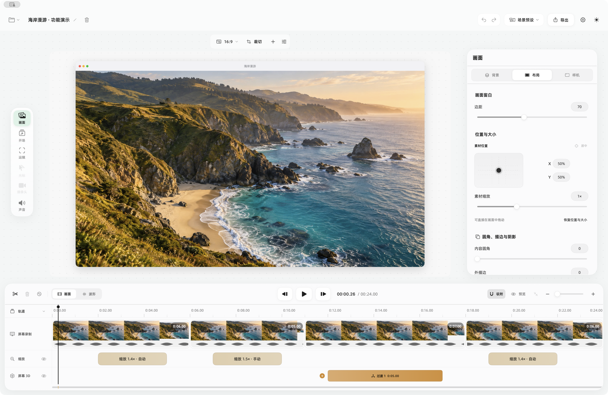
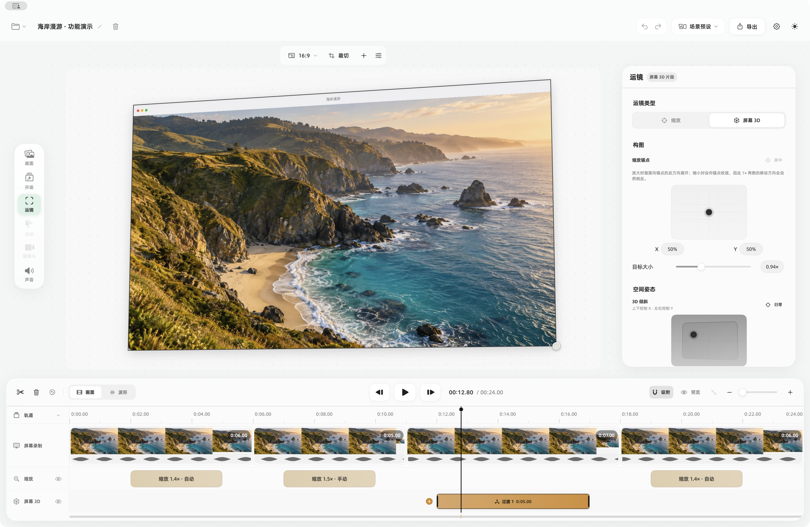

<p align="center">
  
</p>

<h1 align="center">DogSC</h1>

<p align="center">
  <b>录得清楚，剪得轻松，运镜自然。</b><br>
  macOS 原生的录屏与轻量剪辑工具。
</p>

<p align="center">
  
  
  
  
</p>

<p align="center">
  <a href="https://github.com/laogou717/dogsc/releases/latest"><b>下载</b></a>
  &nbsp;·&nbsp;
  <a href="#从源码构建">从源码构建</a>
  &nbsp;·&nbsp;
  <a href="https://github.com/laogou717/dogsc/issues">反馈问题</a>
</p>

<p align="center">
  
</p>

## 功能

<table>
  <tr>
    <td width="50%" valign="top">
      <b>录制</b><br>
      显示器、窗口、区域，或用数据线连接的 iPhone／iPad。同时录摄像头、麦克风和系统声音。
    </td>
    <td width="50%" valign="top">
      <b>剪辑</b><br>
      分割、裁剪、重排、变速与恢复剪辑。缩略图和波形随时切换，边界自动吸附。
    </td>
  </tr>
  <tr>
    <td valign="top">
      <b>运镜</b><br>
      自动跟随光标与手动缩放；屏幕 3D 的倾斜、透视与聚焦虚化；开场动效。
    </td>
    <td valign="top">
      <b>画面</b><br>
      比例、裁切、留白、圆角、阴影、背景与样机外框；贴图、柔化与突出；场景预设。
    </td>
  </tr>
  <tr>
    <td valign="top">
      <b>光标与摄像头</b><br>
      光标样式、点击反馈、静止隐藏与时间校准；摄像头布局与出场动画。
    </td>
    <td valign="top">
      <b>导出</b><br>
      MP4 或 M4A；原始素材、1080p、1440p、4K；30／60 FPS。项目随时可以继续编辑。
    </td>
  </tr>
</table>

<p align="center">
  
</p>

## 小技巧

- 录制时按 <kbd>⌃</kbd><kbd>⌥</kbd><kbd>M</kbd> 留下剪辑标记，之后在时间线上找回口误或重点。
- 悬浮备忘录可以当提词器用，它不会被录进画面。
- 在缩放、屏幕 3D 或摄像运动轨道上，用 <kbd>Shift</kbd> 单击连续选择，<kbd>⌘</kbd> 单击增减选择，<kbd>⌘</kbd><kbd>A</kbd> 全选当前运镜轨道；按 <kbd>Delete</kbd> 或 <kbd>D</kbd> 批量删除，<kbd>⌘</kbd><kbd>Z</kbd> 一次撤销。
- 在时间线上用 <kbd>⌘</kbd><kbd>C</kbd>／<kbd>⌘</kbd><kbd>V</kbd> 复制效果片段，<kbd>⌘</kbd><kbd>⇧</kbd><kbd>V</kbd> 只粘贴属性。
- 完整快捷键见菜单栏「显示 → 快捷键速查」。

## 开始使用

1. 从 [Releases](https://github.com/laogou717/dogsc/releases/latest) 下载 DMG，把 DogSC 拖入「应用程序」。
2. 按引导开启屏幕录制与辅助功能权限，麦克风和摄像头按需授权。
3. 界面语言在「设置 → 通用」中切换，即时生效。

> [!NOTE]
> 当前测试版使用 Apple Development 签名，尚未经过 Apple 公证。首次打开如被拦截，请在「系统设置 → 隐私与安全性」中点「仍要打开」（[Apple 说明](https://support.apple.com/zh-cn/102445)）。请只从本仓库的 Releases 下载。

## 从源码构建

<details>
<summary>需要 Apple Silicon Mac、Xcode 26+ 和你自己的 Apple Development 证书</summary>

<br>

```bash
git clone https://github.com/laogou717/dogsc.git
cd dogsc

# 找到自己证书的 40 位 SHA-1 指纹
security find-identity -v -p codesigning

DOGSC_SIGNING_IDENTITY="<SHA-1 指纹>" bash build-app.sh
open ".build/local/DogSC Dev.app"
```

- 脚本完成 Release 编译，组装图标、字体、本地化与 Sparkle，并签名整个 App。单独 `swift build` 不会生成 `.app`。
- 开发版 `DogSC Dev`（`cn.laogou.dogsc.dev`）与正式版的偏好和系统权限相互独立，也不接收正式版更新。
- Xcode 不在 `/Applications` 时，用 `DEVELOPER_DIR` 指定位置。首次构建需要联网下载 Sparkle。

</details>

## 许可

源代码采用 [MIT License](LICENSE)。随附字体遵循其自身许可，见 [字体说明](Resources/Fonts/README.md)。
